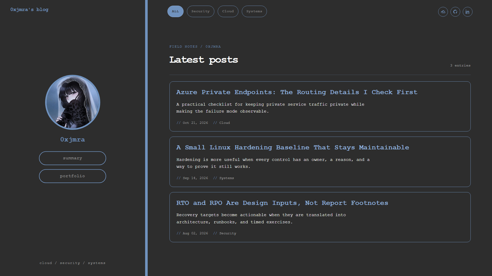

# 0xjmra's Technical Blog 🚀

A clean, minimalist, and responsive personal technical blog for sharing field notes, projects, and insights on Cloud Infrastructure, Cyber Security, and Systems Administration.

🌐 **[Visit the Live Blog Here](https://ranaabdelsalamm.github.io/0xjmra_Blog/)**

## 📸 Preview


## 🛠️ Tech Stack
- **Frontend:** HTML5, CSS3 (Custom Design System)
- **Logic:** Vanilla JavaScript (No heavy frameworks)
- **Markdown Parsing:** [marked.js](https://github.com/markedjs/marked) (Client-side rendering)
- **Hosting & CI/CD:** GitHub Pages

## 📝 How to Add a New Post (Admin Notes)
1. Create a new `.md` file inside the `posts/` directory.
2. Include the required YAML-style front-matter at the very top:
   ```text
   ---
   Title: "Post Title Here"
   Date: YYYY-MM-DD
   Category: Cloud / Security / Systems
   Excerpt: "Short description of the post..."
   ---
